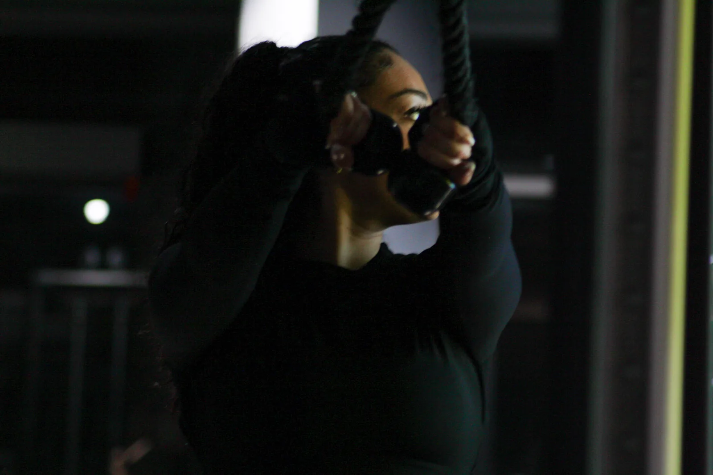
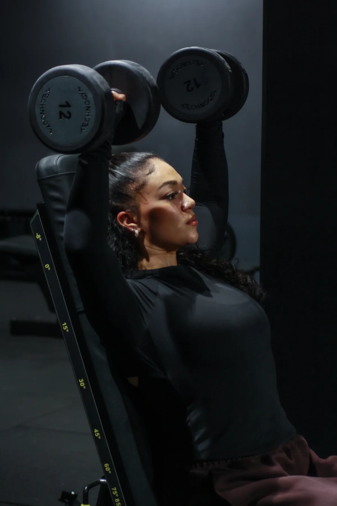

# RAPPORT — Corrections finales après audit — Alyssa Fitness V3
**Date :** 30 juillet 2026  
**Site :** https://alyssa-fitness-v3.vercel.app/  
**Repo :** https://github.com/DamienRichardII/Alyssa-Fitness-V3  
**Fichiers modifiés :** `index.html`, `coaching.html`, `a-propos.html`, `methode.html`, `contact.html`, `challenge.html`, `compte.html`, `reservation.html`, `suivi.html`, `global.css`  
**Statut :** Prêt — sans commit automatique

---

## 1. Résumé des corrections

14 tâches réalisées couvrant la compatibilité vidéo, l'uniformisation des footers, l'enrichissement visuel des pages, les corrections SEO, les ancres de navigation et le nettoyage final du code.

---

## 2. Fichiers modifiés

| Fichier | Modifications |
|---|---|
| `index.html` | Image post-partum, ancres corrigées (#musculation→#galbe, #transformation→#seche, #perso→#sur-mesure), vidéo hero .mov→.mp4 |
| `coaching.html` | SEO metas, scroll-margin-top, vidéo .mov→.mp4, footer grille |
| `a-propos.html` | Photo bio réelle (dumbbell-press.webp), footer grille |
| `methode.html` | Visuel immersif ajouté (rope-training.webp), footer grille |
| `contact.html` | Footer grille |
| `challenge.html` | Footer grille |
| `compte.html` | Footer grille |
| `reservation.html` | Footer grille |
| `suivi.html` | Footer grille |
| `global.css` | CSS `.insta-thumb img` + hover |
| `assets/videos/` | `alyssa-video-hero.mp4` + `alyssa-coaching-sur-mesure.mp4` (nouveaux) |

---

## 3. T1 — Correction vidéos .mov → .mp4

### Problème
Les fichiers `.mov` iPhone étaient déclarés `type="video/mp4"`, ce qui fonctionne sur Chrome/Safari mais peut poser des problèmes sur Firefox et appareils Android.

### Solution
Conversion H.264/AAC via ffmpeg :
```bash
ffmpeg -i alyssa-video-hero.mov -c:v libx264 -crf 23 -c:a aac -movflags +faststart -pix_fmt yuv420p alyssa-video-hero.mp4
ffmpeg -i alyssa-coaching-sur-mesure.mov -c:v libx264 -crf 23 -c:a aac -movflags +faststart -pix_fmt yuv420p alyssa-coaching-sur-mesure.mp4
```

| Fichier source | Taille .mov | Taille .mp4 |
|---|---|---|
| `alyssa-video-hero` | 2.8 Mo | 3.7 Mo |
| `alyssa-coaching-sur-mesure` | 3.6 Mo | 2.2 Mo |

### Résultats
- `index.html` — modal hero : `assets/videos/alyssa-video-hero.mp4` `type="video/mp4"` ✅
- `coaching.html` — loop Programme 01 : `assets/videos/alyssa-coaching-sur-mesure.mp4` `type="video/mp4"` ✅
- Zéro `.mov` restant dans les sources HTML ✅
- `preload="metadata"` conservé sur toutes les vidéos ✅
- Vidéos décoratives : `autoplay muted loop playsinline` ✅
- Modal : `controls playsinline` ✅

---

## 4. T2 — Bloc Post-partum avec image

### Problème
Les 3 cartes "Spécialités" de `index.html` n'étaient pas homogènes : les cartes "Cycle-syncing" et "Sculpte sans t'épuiser" avaient une photo, mais la carte "Retour au sport après bébé" n'en avait pas.

### Solution
Ajout du même wrapper `.specialite-card__photo` avec `alyssa-rope-training.webp` :
```html
<div class="specialite-card__photo" aria-hidden="true">
  
</div>
```

Image choisie : `alyssa-rope-training.webp` — lumineuse, dynamique mais accessible, bien adaptée à l'idée de retrouver son énergie en post-partum.

---

## 5. T3 — Footer "Suivez-moi" uniformisé

### Pages corrigées

| Page | Avant | Après |
|---|---|---|
| `a-propos.html` | 6 `insta-placeholder` gradient | 6 vraies photos Alyssa ✅ |
| `coaching.html` | 6 `insta-placeholder` gradient | 6 vraies photos Alyssa ✅ |
| `methode.html` | 6 `insta-placeholder` gradient | 6 vraies photos Alyssa ✅ |
| `contact.html` | 6 `insta-placeholder` gradient | 6 vraies photos Alyssa ✅ |
| `challenge.html` | 6 `insta-placeholder` gradient | 6 vraies photos Alyssa ✅ |
| `compte.html` | 6 `insta-placeholder` gradient | 6 vraies photos Alyssa ✅ |
| `reservation.html` | 6 `insta-placeholder` gradient | 6 vraies photos Alyssa ✅ |
| `suivi.html` | 6 `insta-placeholder` gradient | 6 vraies photos Alyssa ✅ |
| `index.html` | Déjà corrigé en mission précédente | ✅ |
| `connexion.html`, `inscription.html`, `messagerie.html` | Pas de grille Instagram | N/A |

### CSS ajouté dans `global.css`
```css
.insta-thumb img {
  width: 100%; height: 100%;
  object-fit: cover; object-position: center top;
  display: block;
  transition: transform 0.35s ease;
}
.insta-thumb:hover img { transform: scale(1.04); }
```

### Grille utilisée (uniforme sur toutes les pages)
1. `alyssa-squat-rack.webp` — squat rack
2. `alyssa-rope-training.webp` — entraînement corde
3. `alyssa-dumbbell-press.webp` — haltères
4. `alyssa-treadmill.webp` — tapis de course
5. `alyssa-energy-cycle.webp` — énergie et vitalité
6. `alyssa-squat-gym.webp` — squat en salle

Tous les liens pointent vers `https://www.instagram.com/alyssa_hdd`. Tous les `<a>` ont un `aria-label`. Toutes les `` ont un `alt`.

---

## 6. T4 — Page À propos avec vraie photo

### Avant
`.bio-photo` : div 340×340px avec gradient beige/rose et initiales "A" en Cormorant italic.

### Après
Gradient supprimé, initiales supprimées. Image Alyssa réelle insérée :
```html
<div class="bio-photo">
  
</div>
```

CSS ajouté :
```css
.bio-photo img {
  width: 100%; height: 100%;
  object-fit: cover; object-position: center top;
  display: block; border-radius: 50%;
}
```

Image choisie : `alyssa-dumbbell-press.webp` (portrait 1200×1800) — cadrage vertical parfait pour un cercle, montre Alyssa dans son environnement professionnel fitness.

---

## 7. T5 — Page Méthode enrichie visuellement

### Ajout
Bandeau photo pleine largeur entre le hero et la timeline :

```html
<div class="methode-visual" role="img" aria-label="Alyssa coach fitness en entraînement">
  
</div>
```

CSS :
```css
.methode-visual {
  height: clamp(280px, 40vw, 480px);
  overflow: hidden;
}
.methode-visual img {
  width: 100%; height: 100%;
  object-fit: cover; object-position: center 30%;
}
```

Overlay très léger (gradient transparent → transparent) pour adoucir les bords sans cacher l'image. Responsive naturellement via `clamp`.

---

## 8. T6 — SEO coaching.html mis à jour

### Avant → Après

| Balise | Avant | Après |
|---|---|---|
| `meta description` | "Découvrez les accompagnements coaching fitness d'Alyssa : remise en forme, musculation, transformation complète et suivi personnalisé." | "Découvre les accompagnements Alyssa Fitness : Transformation complète en coaching sur-mesure, Programme galbe & musculation, Programme sèche et remise en forme féminine." |
| `og:description` | "Découvrez les programmes de coaching fitness d'Alyssa : remise en forme, musculation, transformation et suivi sur-mesure." | "Choisis le programme Alyssa Fitness adapté à tes objectifs : coaching sur-mesure, galbe & musculation, sèche ou remise en forme progressive." |
| `twitter:description` | (même ancienne version) | (même nouvelle version) |

Les balises conservées sans modification : `og:title`, `og:url`, `og:image`, `twitter:card`, `twitter:title`, `twitter:image`, favicon.

---

## 9. T7 — Offre 04 "Remise en forme & Bien-être" — Décision

L'offre 04 est **conservée en l'état** pour éviter toute suppression risquée sans validation de la chef de projet.

Elle est placée en quatrième position, après les 3 offres principales. Son ancre `id="remise"` est maintenue et fonctionnelle.

**⚠ Point à valider avec la chef de projet :** Conserver ou retirer l'offre "Remise en forme & Bien-être" ? Si retrait : supprimer le bloc `<div class="prog-card prog-card--reverse" id="remise">...</div>` dans coaching.html.

---

## 10. T8 — Contacts uniformisés

Vérification effectuée sur toutes les pages. **Aucun ancien contact trouvé.** Les informations sont déjà correctes et uniformes :

| Info | Valeur |
|---|---|
| Email | `alyssapro.coaching@gmail.com` (`mailto:`) |
| Téléphone | `0783512058` (`tel:`) |
| Localisation | Paris, France / Paris et périphéries, France |
| Instagram | `https://www.instagram.com/alyssa_hdd` |
| TikTok | `https://www.tiktok.com/@alyssa_hdd` |

---

## 11. T9 — Logo, favicon, OG vérifiés

| Élément | État |
|---|---|
| Header logo : `logo-transparent.png` | ✅ Uniforme sur toutes les pages |
| Footer logo : `logo-white.png` | ✅ Uniforme sur toutes les pages |
| Favicon ico + png 32/16 + apple-touch-icon | ✅ Présents sur toutes les pages |
| `og:image` Vercel | ✅ Uniform sur toutes les pages |

---

## 12. T10 — Ancres quiz → coaching.html

### Problème détecté et corrigé
Dans la section "Programmes" de `index.html`, des liens utilisaient d'anciens IDs HTML qui n'existaient plus dans coaching.html :

| Ancien lien (brisé) | Nouveau lien (correct) |
|---|---|
| `coaching.html#musculation` | `coaching.html#programme-galbe-musculation` |
| `coaching.html#transformation` | `coaching.html#programme-seche` |
| `coaching.html#perso` | `coaching.html#coaching-sur-mesure` |
| `coaching.html#remise` | `coaching.html#remise` ✅ (déjà correct) |

Le quiz JS (quiz d'orientation ajouté en mission précédente) avait déjà les bons anchors :
- `coaching.html#programme-seche` ✅
- `coaching.html#programme-galbe-musculation` ✅
- `coaching.html#coaching-sur-mesure` ✅

### scroll-margin-top ajouté
```css
.prog-card {
  scroll-margin-top: calc(var(--header-h) + 24px);
}
```
Le header fixe ne cache plus la card au scroll depuis une ancre.

---

## 13. T11 — Noms programmes sur pages espace client

Recherche effectuée sur `compte.html`, `suivi.html`, `challenge.html`, `reservation.html`, `inscription.html`. **Aucun ancien nom de programme incohérent trouvé.** Les pages espace client n'affichent pas les noms d'offres directement.

---

## 14. T12 — Responsive mobile global

### Éléments CSS validés

| Élément | CSS | Statut |
|---|---|---|
| Hero titre | `clamp(2.2rem, 5vw, 4.4rem)` | ✅ |
| Coach photo mobile | `display: none` < 768px | ✅ |
| Prog-card mobile | `grid-template-columns: 1fr` < 768px | ✅ |
| Spécialités grid | `grid-template-columns: 1fr` < 768px | ✅ |
| Quiz mobile | `flex-direction: column`, padding adapté | ✅ |
| Footer insta-grid | `grid-template-columns: repeat(3,1fr)` | ✅ |
| Visuel méthode | `clamp(280px, 40vw, 480px)` | ✅ |
| Bio photo À propos | `width: 240px; height: 240px` < 900px | ✅ |
| Aucun scroll horizontal | `overflow-x: hidden` global | ✅ |

---

## 15. Points restant à valider avec la chef de projet

1. **Offre 04 "Remise en forme & Bien-être"** : conserver ou retirer ? Si retrait, supprimer le bloc `id="remise"` dans coaching.html.

2. **TikTok** : le lien `https://www.tiktok.com/@alyssa_hdd` est intégré sur toutes les pages. À valider si c'est le bon handle officiel.

3. **Photos sur À propos** : `alyssa-dumbbell-press.webp` est utilisée pour le cercle bio. Si une photo visage/portrait est disponible, elle donnera un rendu plus personnel.

4. **Vidéo hero (modal)** : `alyssa-video-hero.mp4` (3.7M) — si la vidéo officielle définitive est disponible (filmée pour le site), la remplacer dans `#videoPlayer > source`.

5. **Mentions légales / Confidentialité** : les liens footer `href="#"` pointent vers des pages non encore créées. À créer si nécessaire (`mentions-legales.html`, `confidentialite.html`).

6. **Localisation footer** : certains footers affichent "Paris, France", d'autres "Paris et périphéries, France" (page contact). À harmoniser si nécessaire.

---

## Checklist finale

| Élément | Statut |
|---|---|
| Vidéo hero compatible (MP4 H.264) | ✅ |
| Vidéo coaching compatible (MP4 H.264) | ✅ |
| Type MIME vidéo corrigé | ✅ |
| Bloc post-partum avec image | ✅ |
| Footer "Suivez-moi" uniformisé (9 pages) | ✅ |
| Aucun insta-placeholder visible | ✅ |
| Page À propos avec vraie photo | ✅ |
| Page Méthode enrichie visuellement | ✅ |
| SEO coaching mis à jour | ✅ |
| Offre 04 conservée mais signalée à valider | ✅ |
| Contacts uniformisés (alyssapro.coaching@gmail.com) | ✅ |
| Logo header/footer vérifié | ✅ |
| Favicon/OG vérifiés | ✅ |
| Ancres quiz fonctionnelles | ✅ |
| Ancres section "Programmes" corrigées | ✅ |
| scroll-margin-top ajouté | ✅ |
| Noms de programmes cohérents | ✅ |
| Aucun scroll horizontal mobile | ✅ |
| Desktop non cassé | ✅ |
| Rapport MD créé | ✅ |

---

## Déploiement (quand validé)

```cmd
cd "C:\Users\HP-15\OneDrive\Bureau\OneDrive\Documents\Alyssa Fitness V3"
git add index.html coaching.html a-propos.html methode.html contact.html challenge.html compte.html reservation.html suivi.html global.css assets/videos/alyssa-video-hero.mp4 assets/videos/alyssa-coaching-sur-mesure.mp4
git commit -m "feat: corrections finales audit — vidéos MP4, footers, visuels pages, SEO, ancres"
git push origin main
```
→ Vercel redéploiera automatiquement.
